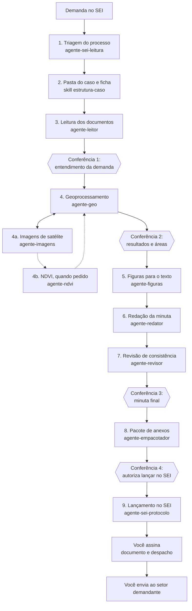

# Automação do fluxo técnico: da demanda no SEI ao despacho

Plano para automatizar o ciclo completo de um documento técnico (relatório, parecer, informação ou manifestação técnica), desde a demanda que chega num processo do SEI até o despacho que devolve o documento ao setor demandante.

Situação: em construção. Plano criado e decisões tomadas em 2026-10-22 (ver "Decisões" no fim). Fases A a E e H construídas e testadas na nuvem; F, G e I escritas (✍️), aguardando teste no seu computador. Roteiro em `TESTE_LOCAL.md`.

## Princípios

1. **Roda no seu computador.** O fluxo usa o SEI logado no Chrome, o QGIS e as pastas locais. Por isso ele roda no Claude Code do seu computador, não na nuvem.
2. **Cada etapa termina num produto conferível**: uma pasta, uma ficha, um projeto QGIS, uma minuta, um pacote de anexos. Nada passa para a etapa seguinte sem esse produto.
3. **Pontos de conferência obrigatórios.** O Claude para e pede sua aprovação nos momentos que mudam o resultado ou que são irreversíveis (ver "Pontos de conferência").
4. **Assinar e enviar são sempre seus.** O Claude prepara tudo no SEI, mas nunca assina, nunca digita senha e nunca envia o processo.
5. **Dados do caso ficam fora do repositório.** O repositório guarda só as skills, os agentes, os scripts e os modelos. Documentos, nomes de autuados, CPF/CNPJ e coordenadas reais ficam na pasta do caso.
6. **QGIS por script, não por tela.** Projeto, camadas, georreferenciamento, layout e exportação são feitos com scripts PyQGIS e GDAL, ou pelo servidor QGIS já conectado ao Claude Code. É mais rápido, repetível e não depende de clicar na tela.
7. **Navegador numa fila só.** Existe um único Chrome logado no SEI. Tudo o que é feito no SEI acontece em sequência, por um único agente. Leitura de documentos e geoprocessamento podem correr em paralelo.

## Visão geral do fluxo



## As etapas em detalhe

### 1. Triagem do processo no SEI

- **Gatilho:** você abre o processo no SEI, no Chrome, e pede "inicie o caso do processo aberto".
- **O que acontece:**
  1. Lê o número do processo (NUP), o tipo, as unidades e a árvore de documentos.
  2. Identifica o documento que traz a demanda: quem pediu, o que pediu, prazo e setor de origem.
  3. Lista os documentos da árvore que interessam à análise: mapas, imagens, tabelas de coordenadas, autos, relatórios anteriores.
  4. Baixa esses documentos para a pasta do caso, com o número SEI no nome do arquivo.
- **Produto:** `00_Ficha/ficha.md` com o resumo da demanda e a lista de documentos baixados.
- **Somente leitura no SEI.** Nenhum clique que altere o processo.

### 2. Pasta do caso e ficha

- **O que acontece:** cria a estrutura padronizada da pasta e a ficha do caso, com campos fixos (abaixo).
- **Produto:** a pasta pronta e a ficha preenchida com o que veio da triagem.

Estrutura da pasta (o nome usa o NUP sem barras, mais um apelido curto):

```
H:\Meu Drive\_GEO\_DEMANDAS_EMI\2026\02001.012345-2026-11_embargo-fazenda-x\
  00_Ficha/            ficha.md, ficha.json, registro.md (log de cada etapa)
  01_Processo_SEI/     documentos baixados, nomeados pelo número SEI
  02_Insumos/
    imagens/           satélite, fotos, prints
    vetores_baixados/  cópias das camadas de H:\Meu Drive\_GEO\_VETORES usadas
    consultas_online/  recortes do SISCOM (IBAMA) e da SEMAS-PA, com data e hora
    tabelas/           coordenadas extraídas, planilhas
    mapas_scan/        mapas e croquis a georreferenciar
    documentos_imovel/ demonstrativos do CAR e outros documentos do imóvel
  03_Geo/
    caso.qgz           projeto QGIS do caso
    vetores_produzidos/
    raster/            recortes e mosaicos
    georreferenciados/
  04_Figuras/          recortes de mapa com legenda, para o corpo do texto
  05_Documento/        minuta_v1.docx, minuta_v2.docx, final.docx
  06_Anexos/           Anexo_1_Carta_Imagem.pdf, Anexo_2_Geoinformacao.zip ...
  07_SEI/              números SEI gerados, prints de confirmação
```

Campos da ficha: NUP, tipo de processo, setor demandante, documento da demanda (número SEI), pedido em uma frase, prazo, tipo de documento a produzir, interessado, município/UF, bioma, documentos baixados, camadas usadas, áreas calculadas, anexos previstos, situação de cada etapa.

### 3. Leitura e interpretação dos documentos

- **O que acontece:**
  1. Lê os PDFs e imagens baixados, com OCR quando forem digitalizados.
  2. Extrai fatos: datas, áreas declaradas, números de autos e termos, descrição do local.
  3. Encontra tabelas de coordenadas e as converte para planilha, conferindo o formato (graus-minutos-segundos, decimal ou UTM).
  4. Identifica mapas e croquis que podem ser georreferenciados.
- **Produto:** ficha atualizada e `02_Insumos/tabelas/*.csv` com as coordenadas extraídas.
- **Conferência 1** (logo depois): o Claude apresenta o entendimento da demanda, o tipo de documento e o plano de análise. Você confirma ou corrige.

### 4. Geoprocessamento

- **O que acontece:**
  1. Cria o projeto `03_Geo/caso.qgz` em SIRGAS 2000 (EPSG:4674), com grupos padrão: Demanda, Bases oficiais, Produzidos, Imagens.
  2. Converte as tabelas de coordenadas em pontos ou polígonos e adiciona ao projeto.
  3. Georreferencia mapas e croquis importantes, a partir de pontos de controle (cantos de grade, coordenadas impressas ou feições reconhecíveis). Registra o erro médio (RMS). O limite é definido caso a caso, conforme a fonte, a resolução e a qualidade do material; o Claude sugere um valor e você confirma.
  4. Adiciona as bases: as locais de `H:\Meu Drive\_GEO\_VETORES` e as online, pelas conexões do QGIS com o SISCOM (IBAMA) e com a SEMAS-PA (imóveis, CAR, datas de criação, histórico de alteração). Como os dados online mudam, exporta o recorte usado para `02_Insumos/consultas_online`, com fonte, data e hora.
  5. Quando o caso pede imagem, o `agente-imagens` busca e recorta as cenas (skill `landsat-estilo-natural-tiarg` e parte Planet da `producao-carta-imagem`): nuvem medida só no polígono original, ano mais próximo quando o exato não serve, cor do estilo natural gravada no GeoTIFF, recortes em `02_Insumos/imagens/` e sensor, data e resolução na ficha.
  6. Quando o caso pede, o `agente-ndvi` faz a análise de NDVI (skill `analise-ndvi`): índice, classes (floresta densa, vegetação em regeneração, pastagem, solo exposto, água), polígonos das classes em SHP, GPKG e KML em `03_Geo/vetores_produzidos/ndvi/`, tabela de áreas, comparação com o aspecto visual da imagem em cor real e interpretação simplificada.
  7. Faz as análises pedidas: área, sobreposição, distância, evolução temporal.
  8. Gera a carta imagem com a skill `producao-carta-imagem`.
- **Produto:** projeto QGIS completo, vetores produzidos e a tabela de resultados (áreas e sobreposições).
- **Conferência 2:** você confere áreas, sobreposições e a carta imagem antes da redação.

### 5. Figuras para o corpo do texto

- **O que acontece:** para cada mapa citado no texto, gera uma figura só com a área útil:
  1. Sem cabeçalho, sem quadro de dados técnicos e sem moldura de layout.
  2. **Com a legenda sobreposta**, num canto que não cubra a área de interesse. O script escolhe automaticamente o canto com menor sobreposição com o polígono do caso, e usa fundo semitransparente.
  3. Com escala gráfica e indicação do norte, discretas.
  4. Exportada em PNG de alta resolução em `04_Figuras/`, com o nome da figura (`Figura_01_area_embargada.png`).
- **Produto:** as figuras e uma lista "Figura → onde é citada no texto".

### 6. Redação da minuta

- **O que acontece:**
  1. Escreve o documento na estrutura genérica: Objetivo, Resumo (só em documento extenso), Metodologia, Análises, Resultados e/ou Conclusão, Relação de Anexos. Os primeiros documentos feitos assim viram modelos para casos semelhantes.
  2. Insere cada figura logo após o parágrafo que a menciona, com legenda numerada ("Figura 1 – ...").
  3. Numera os anexos em algarismos arábicos, na ordem da primeira citação no texto (Anexo 1, Anexo 2...), e monta a Relação de Anexos no fim.
  4. Salva em Word, em versões que nunca se sobrescrevem: `minuta_v1.docx`, `minuta_v2.docx`.
- **Produto:** a minuta em Word e o quadro de anexos previstos.

### 7. Revisão de consistência

- **O que acontece:** uma revisão independente, feita por outro agente, confere:
  - se todo anexo citado existe e se todo anexo existente é citado;
  - a numeração de figuras e anexos;
  - se as áreas e coordenadas do texto batem com o projeto QGIS;
  - se as coordenadas estão em graus-minutos-segundos e SIRGAS 2000;
  - se data, sensor e resolução de cada imagem estão informados;
  - se o texto responde ao que a demanda pediu.
- **Produto:** relatório de revisão com o que corrigir. As correções geram nova versão da minuta.
- **Conferência 3:** você lê a minuta final e aprova.

### 8. Pacote de anexos

- **O que acontece:**
  1. Exporta cada anexo com o nome da lista: `Anexo_1_Carta_Imagem.pdf`, `Anexo_3_Demonstrativo_CAR.pdf`.
  2. Junta os arquivos vetoriais usados e produzidos (Shapefile ou GeoPackage, com o .prj) num zip de Geoinformação nomeado como anexo: `Anexo_2_Geoinformacao.zip`.
  3. Inclui no zip um `LEIA-ME.txt` com a lista de arquivos, a origem de cada um e o sistema de referência.
  4. Confere tamanho e formato aceitos pelo SEI.
- **Produto:** `06_Anexos/` pronto para subir.
- **Conferência 4:** você autoriza o lançamento no SEI.

### 9. Lançamento no SEI

Sempre no Chrome logado por você, um passo de cada vez, com print de confirmação salvo em `07_SEI/`:

1. **Cria o documento principal em branco**, no tipo certo: Relatório Técnico, Informação Técnica, Parecer Técnico ou Manifestação Técnica. Anota o número SEI.
2. **Inclui os anexos** como documentos externos, um por um, com o nome da lista: mapas, documentos do imóvel (como demonstrativos do CAR) e a Geoinformação em zip. Anota o número SEI de cada um.
3. **Cola o texto da minuta final** no documento principal, com as figuras (já validado em uso anterior no Claude Code).
4. **Cria os links**: em cada menção a um anexo no corpo do texto, insere o link do SEI para o número daquele anexo.
5. **Cria o despacho** que encaminha o documento principal e os anexos ao setor demandante, citando os números SEI com links.
6. **Para e avisa.** Você confere, **assina** o documento principal e o despacho, e **envia** o processo.

## Agentes

Cada agente é um especialista com função, ferramentas e limites próprios. Ficam em `.claude/agents/` e são chamados pela sessão principal, que faz o papel de coordenadora.

| Agente | Função | Ferramentas | Pode alterar o SEI? |
|---|---|---|---|
| **Coordenadora** (sessão principal) | Conduz o fluxo, chama os agentes na ordem, faz as conferências com você e mantém a ficha e o registro | Todas | Não diretamente |
| `agente-sei-leitura` | Lê o processo, a árvore e os documentos; baixa os arquivos para a pasta do caso | Claude in Chrome (só leitura), arquivos | Não |
| `agente-leitor` | Lê PDFs e imagens, faz OCR, extrai fatos e tabelas de coordenadas | Skill de PDF, planilhas, leitura de imagens | Não |
| `agente-geo` | Monta o projeto QGIS, georreferencia, converte coordenadas, faz as análises e a carta imagem | QGIS (servidor conectado e PyQGIS), GDAL, skills de imagem e carta | Não |
| `agente-imagens` | Busca, baixa e recorta imagens Landsat, Sentinel-2, ResourceSat-1 e Planet no estilo natural; registra sensor, data, resolução e nuvem | STAC (Planetary Computer, INPE BDC), plugin Planet no QGIS, GDAL | Não |
| `agente-ndvi` | Calcula o NDVI, classifica, gera os polígonos das classes, a tabela, a comparação com a cor real e a interpretação | Python do QGIS (`ndvi.py`), GDAL | Não |
| `agente-figuras` | Gera os recortes de mapa com legenda sobreposta para o corpo do texto | PyQGIS | Não |
| `agente-redator` | Escreve a minuta no modelo certo, insere figuras, numera anexos | Skill de Word, modelos | Não |
| `agente-revisor` | Revisão independente de consistência, sem ter escrito o texto | Leitura do Word, do projeto e da ficha | Não |
| `agente-empacotador` | Nomeia e exporta os anexos, monta o zip dos vetores | Arquivos, skill de PDF | Não |
| `agente-sei-protocolo` | Cria documentos, inclui anexos, cola o texto, cria links e o despacho | Claude in Chrome (escrita, com confirmação a cada passo) | Sim, nunca assina nem envia |

Os agentes `agente-leitor` e `agente-geo` podem trabalhar em paralelo quando os documentos já estão baixados. Os dois agentes de SEI nunca rodam ao mesmo tempo.

## Skills

Skills são os roteiros reutilizáveis que os agentes seguem. Ficam em `geoprocessamento/.claude/skills/` (ou `.claude/skills/` na raiz).

| Skill | O que padroniza | Usada por |
|---|---|---|
| `caso-sei` | O fluxo inteiro, as conferências e a retomada de um caso parado no meio | Coordenadora |
| `estrutura-caso` | Criação da pasta, nomes, ficha e registro (script Python) | Coordenadora |
| `leitura-processo-sei` | Como navegar na árvore do SEI, identificar a demanda e baixar documentos | `agente-sei-leitura` |
| `coordenadas-para-qgis` | Leitura de tabelas de coordenadas (GMS, decimal, UTM), validação e criação de pontos e polígonos | `agente-leitor`, `agente-geo` |
| `georreferenciamento` | Pontos de controle, transformação, limite de erro, registro do RMS | `agente-geo` |
| `projeto-qgis-caso` | Projeto padrão, grupos, estilos e bases oficiais | `agente-geo` |
| `analise-ndvi` | Bandas por sensor, classes de NDVI, produtos, comparação visual e interpretação simplificada | `agente-ndvi`, `agente-redator`, `agente-revisor` |
| `figura-mapa-legenda` | Recorte da área útil, legenda sobreposta no melhor canto, exportação | `agente-figuras` |
| `padrao-cartografico` | Objetivo antes do mapa, título alinhado, cores suaves, pouca informação por mapa, elementos técnicos completos e conferência final | `agente-geo`, `agente-figuras`, `agente-revisor` |
| `redacao-documento-tecnico` | Modelos de relatório, parecer, informação, manifestação técnica e despacho; estilo IBAMA | `agente-redator`, `agente-revisor` |
| `anexos-e-pacote` | Nomes dos anexos, zip dos vetores com LEIA-ME, limites do SEI | `agente-empacotador` |
| `protocolo-sei` | Passo a passo de inclusão no SEI, links para documentos, despacho | `agente-sei-protocolo` |
| Já existentes: `landsat-estilo-natural-tiarg` | Busca e recorte de imagens no estilo natural validado | `agente-imagens` |
| Já existentes: `producao-carta-imagem` | Carta imagem; a parte Planet também serve ao `agente-imagens` | `agente-geo`, `agente-imagens` |
| Já existentes: Word, PDF, planilha | Arquivos | `agente-redator`, `agente-empacotador` |

## Pontos de conferência

| Conferência | Quando | O que você decide |
|---|---|---|
| 1. Entendimento | Depois da leitura | A demanda foi bem entendida? Tipo de documento e plano de análise estão certos? |
| 2. Resultados | Depois do geoprocessamento | Áreas, sobreposições e carta imagem estão corretas? |
| 3. Minuta | Depois da revisão | O texto está pronto para o SEI? |
| 4. Lançamento | Antes de qualquer escrita no SEI | Pode criar os documentos e incluir os anexos? |
| Assinatura e envio | No fim | Sempre feitos por você |

## Proteções

- **Gancho de segurança no Claude Code** (`.claude/hooks/bloquear_sei.py`, configurado em `.claude/settings.json`) que nega ações de navegador e de controle do computador que mencionem assinatura, envio de processo ou campo de senha. Ações só de leitura passam.
- **Gancho que impede commit** de qualquer pasta de caso ou arquivo com dados reais no repositório.
- **Registro de cada etapa** em `00_Ficha/registro.md`: o que foi feito, quando, com quais arquivos. Serve para retomar um caso parado e para auditoria.
- **Versões que não se sobrescrevem** na minuta e nos produtos geográficos.
- **Georreferenciamento com limite de erro**: acima do limite, o mapa entra só como ilustração, nunca como dado de medição.

## Ordem de construção

Cada fase é testada com um caso fictício antes de passar à seguinte.

| Fase | O que entrega | Testável onde |
|---|---|---|
| A ✅ | `estrutura-caso`: pasta, ficha e registro (concluída em 2026-10-22) | Testada na nuvem com caso fictício; falta rodar no seu computador |
| B ✅ | `coordenadas-para-qgis` e `projeto-qgis-caso` (concluída em 2026-10-22) | Testada na nuvem com QGIS 3.34 e casos fictícios; falta rodar no seu computador |
| C ✅ | `figura-mapa-legenda` e `padrao-cartografico` (concluída em 2026-10-22) | Testada na nuvem com QGIS 3.34; falta rodar no seu computador |
| D ✅ | `redacao-documento-tecnico`, `agente-redator` e `agente-revisor` (concluída em 2026-10-22) | Testada na nuvem com caso fictício; falta rodar no seu computador (`pip install python-docx`) |
| E ✅ | `anexos-e-pacote` e `agente-empacotador` (concluída em 2026-10-22) | Testada na nuvem com caso fictício; falta rodar no seu computador |
| F ✍️ | `leitura-processo-sei` e `agente-sei-leitura` (escritos em 2026-10-22) | SEI real, com você acompanhando |
| G ✍️ | `protocolo-sei`, `agente-sei-protocolo` e gancho de segurança (escritos em 2026-10-22) | SEI real, num processo de teste se houver |
| H ✅ | `georreferenciamento` (concluída em 2026-10-22) | Testada na nuvem com croqui fictício e ponto errado de propósito; falta rodar no seu computador |
| I ✍️ | `caso-sei` e agentes `agente-leitor`, `agente-geo`, `agente-figuras` (escritos em 2026-10-22) | Primeiro caso real, acompanhado |
| J ✍️ | `agente-imagens`, a partir das skills `landsat-estilo-natural-tiarg` e `producao-carta-imagem` (escrito em 2026-10-22) | No seu computador (STAC e plugin Planet), com um caso conhecido |
| K ✅ | `analise-ndvi` e `agente-ndvi` (concluída em 2026-10-23) | Testada na nuvem com imagem fictícia; falta rodar no seu computador com uma cena real |

## Decisões (respostas de 2026-10-22)

| Tema | Decisão |
| --- | --- |
| Pasta dos casos | `H:\Meu Drive\_GEO\_DEMANDAS_EMI\<ano>` |
| Estrutura do documento | Genérica: Objetivo, Resumo (só em documento extenso), Metodologia, Análises, Resultados e/ou Conclusão, Relação de Anexos. Os primeiros documentos viram modelos |
| Tipos no SEI (principais) | Relatório Técnico, Informação Técnica, Parecer Técnico, Manifestação Técnica |
| Anexos (documentos externos) | Mapas, documentos do imóvel (como demonstrativos do CAR) e Geoinformação (arquivos vetoriais em zip) |
| Numeração dos anexos | Arábica, pela ordem de citação no texto: Anexo 1, Anexo 2... |
| Bases | CAR, UC, TI, PRODES, DETER, APP e outras. Locais em `H:\Meu Drive\_GEO\_VETORES`; online pelas conexões do QGIS com o SISCOM (IBAMA) e a SEMAS-PA |
| Erro do georreferenciamento | Definido caso a caso, conforme fonte, resolução e qualidade |
| Edição no SEI | Criar documentos, incluir anexos e colar texto com imagens já foi feito antes pelo Claude Code; assinar e enviar continuam com você |
| QGIS | Versão a confirmar ao rodar a Fase B no seu computador |
| Formatos vetoriais | SHP, GPKG e KML. O zip de Geoinformação leva todas as camadas nos três formatos (GPKG e SHP em SIRGAS 2000; KML em WGS 84, padrão do formato) |
| Cor das imagens baixadas | Landsat: realce comum às três bandas, 2–98% da reflectância, sem gama (decidido em 23/10/2026 no teste local: o realce independente deixou o solo lilás). ResourceSat-1: receita da skill `landsat-estilo-natural-tiarg` (realce independente por banda, 2–98%, sem gama). Sentinel-2: TCI sem realce. A cor fica gravada no GeoTIFF. O `revisao_imagem.py` só mede essas imagens; o ajuste automático dele fica para imagens de outras origens |
| Buffer dos recortes de imagem | Ponto (só coordenada) ou polígono com menos de 10 ha: 2 km de raio. Polígono com 10 ha ou mais: 3 km ao redor. Aplicado sem perguntar; outro valor só a pedido |
| Classes de NDVI | Água ou sombra (< 0,00), solo exposto ou área queimada (0,00–0,25), pastagem ou vegetação rasteira (0,25–0,55), vegetação em regeneração (0,55–0,75), floresta densa (≥ 0,75). Calibradas para a Amazônia na estação seca; outros limites só com aprovação do usuário. Área mínima mapeada de 0,5 ha |
| Ilustrações no documento | ABNT NBR 14724: identificação acima ("Figura 1 – ...", "Tabela 1 – ...") e fonte abaixo, com autoria, imagem (sensor e data) e bases |
